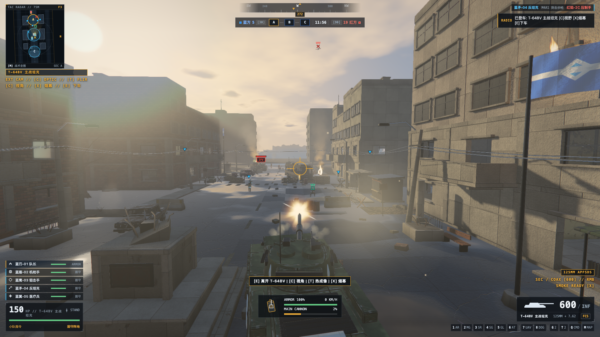
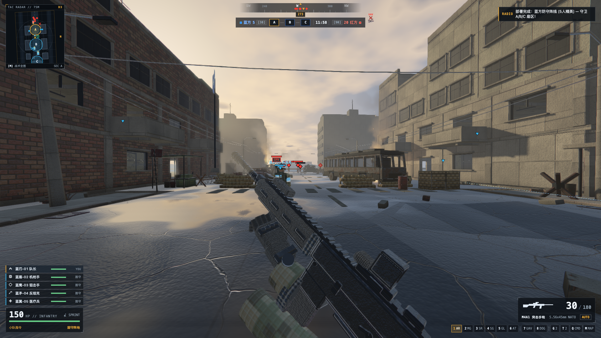
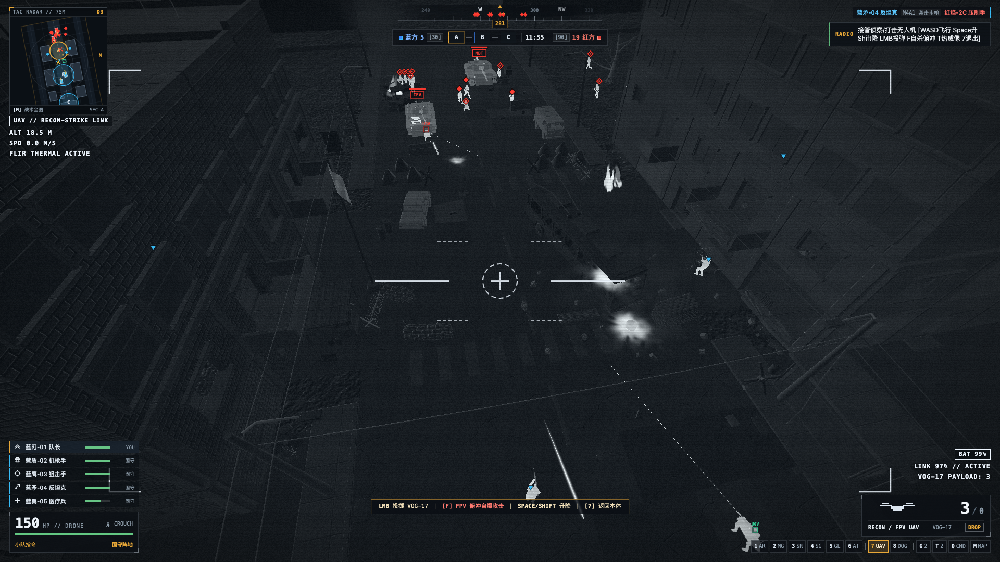
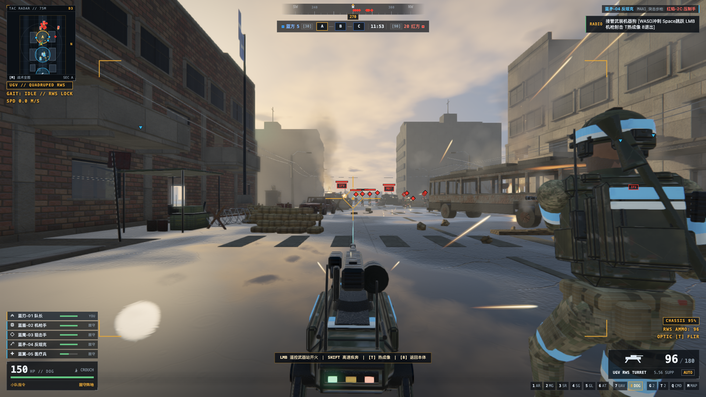
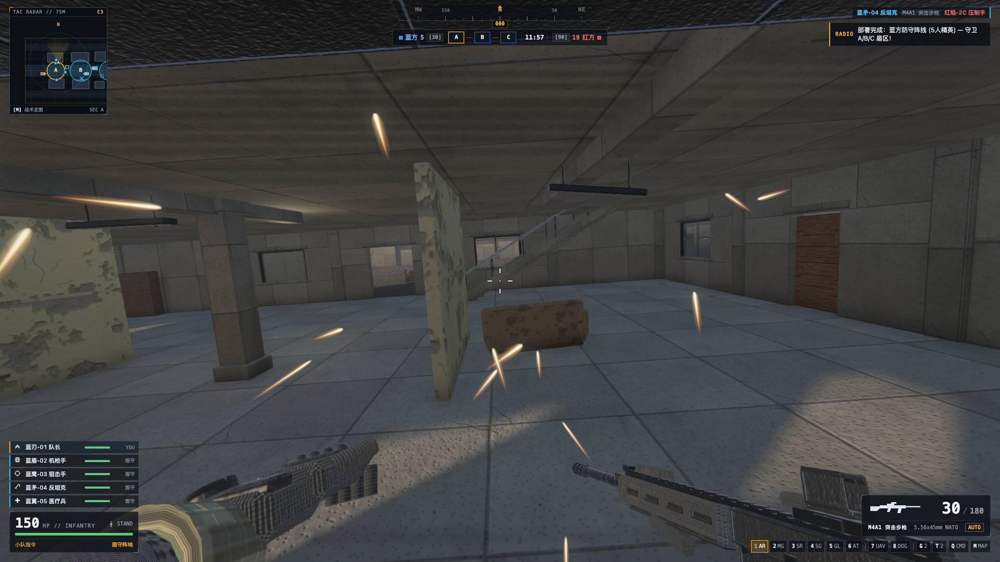
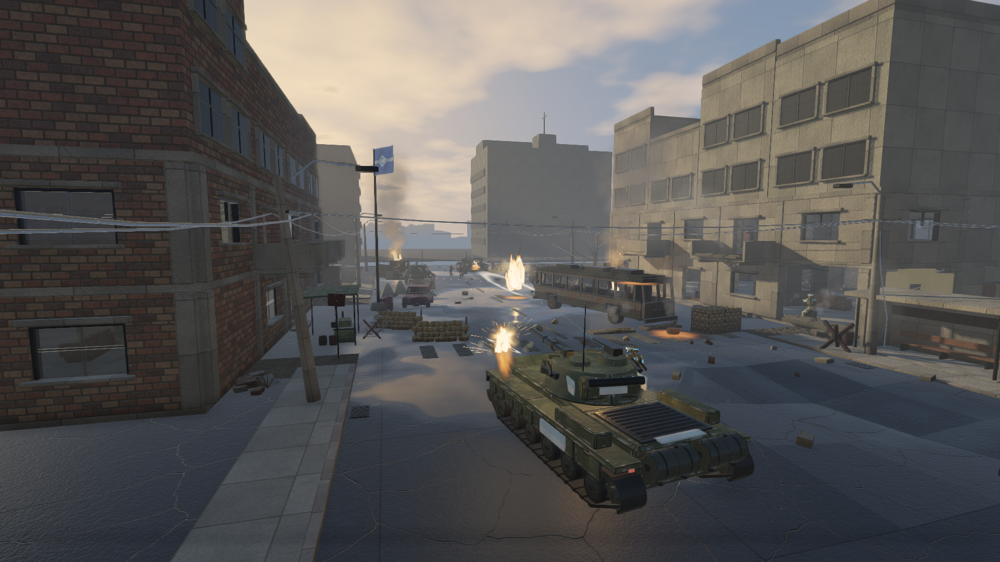

# 城市突破：红蓝对抗 (Urban Breakthrough: Red vs Blue)

纯原生 **WebGL2 PBR** 打造的**单文件离线 3D 现代城市巷战第一人称射击游戏**。全部 3D 模型、PBR 贴图、骨骼与持枪动画、可破坏建筑、载具、无人系统、程序化音效与动态配乐全部自包含于单个 `index.html` 中，**零外部库、零 CDN、零网络资源依赖**，双击即可在桌面浏览器离线运行。

- **在线试玩（GitHub Pages）**：https://lasdrder0705.github.io/urban-breakthrough-fps/
- **离线运行**：直接下载仓库根目录的 [index.html](index.html) 并在桌面 Chrome / Edge / Firefox / Safari 中打开。

## 实机截图（1920×1080）



| 战术疾跑与湿滑水洼倒影 | 无人机高空 FLIR 热成像侦察 |
| :---: | :---: |
|  |  |

| 武装机器狗街头协同突击 | 单手破窗翻越突入室内 |
| :---: | :---: |
|  |  |



## 核心特性

- **零依赖原生 WebGL2 渲染管线**：PCSS 软阴影、半分辨率平面水洼倒影、3D 阴影步进夕阳体积光、GPU 实时烘焙 PBR 材质、ACES/AgX 电影级色调映射、FXAA、CAS 锐化与 FLIR 白热成像模式。
- **5v20 非对称三扇区突破模式**：蓝方 5 人精英防线 vs 红方 20 人四小队合成突击，支持自由选择任意阵营参战；内置增援票数机制、AI 自动补兵、倒地救援、`Space` 接管友军、`F` 快速复活与脱战回血。
- **立体可破坏城市战场**：7 栋可进入多层建筑与车库、无穿模室内楼梯、可摧毁墙体/沙袋/玻璃/引爆车辆与油桶，以及**面朝大窗口按 `W + Space` 破窗翻越**动作。
- **现代步兵武器与载具无人协同**：
  - 6 类现代武器（突击步枪、轻机枪、狙击步枪、霰弹枪、榴弹发射器、反坦克火箭筒），完整分段换弹、抛壳、后坐力与战术疾跑持枪动画。
  - 玩家与 AI 均可驾驶 **主战坦克（T-64BV / T-72B3）** 与 **步兵战车（M2A2 / BMP-2）**。
  - 支持直接接管或 AI 自主协同的 **FPV 察打无人机（`7`）** 与 **四足武装机器狗（`8`）**。
- **程序化 Web Audio 音景**：基于 Web Audio API 实时合成枪声混响、弹道破空、爆炸冲击波、脚步声与动态战斗配乐。

## 操控说明

| 按键 | 功能 |
| :--- | :--- |
| `WASD` / `Shift` / `C` / `Space` | 移动 / 战术疾跑 / 蹲下 / 跳跃 |
| `W + Space`（面朝大窗口） | 单手撑窗破窗翻越 |
| `鼠标左键` / `右键` / `R` / `B` | 开火 / 瞄准开镜 / 换弹 / 切换射速模式 |
| `1` – `6` | 切换步兵武器（AR / MG / SR / SG / GL / AT） |
| `7` / `8` | 接管或退出 FPV 察打无人机 / 武装机器狗 |
| `G` / `T` | 投掷破片手雷 / 烟雾弹（载具或无人视角下 `T` 切换 FLIR 热成像） |
| `E` | 登车/下车、长按救援倒地队友、补充弹药 |
| `Q` / `F1`–`F6` / `M` | 战术指令轮盘 / 小队快捷指令 / 全屏交互战术地图 |
| `Esc` / `P` | 暂停与画质/音量/灵敏度设置 |

## 本地构建

本项目由 `src/` 下的 18 个纯原生 JS 模块与 `src/ui/styles.css` 打包生成单个离线 `index.html`，无需安装任何 npm 依赖（需 Node.js 18+）：

```bash
node build.mjs
```
